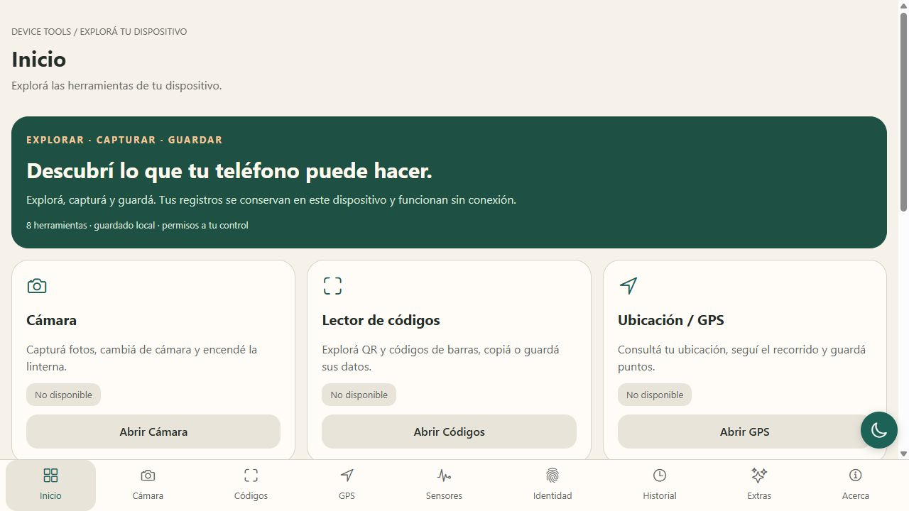
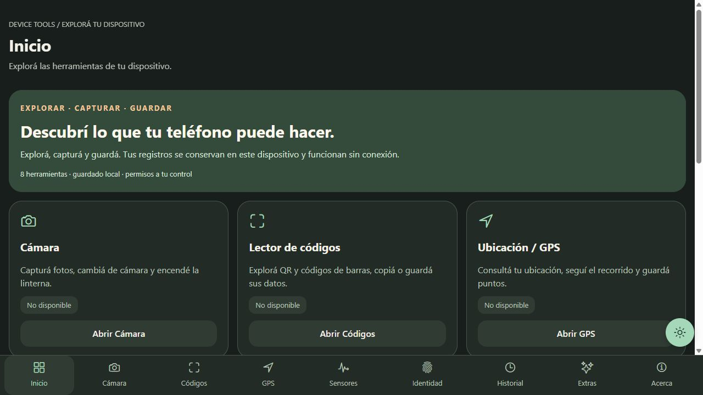

# Device Tools

Aplicación académica de React Native para explorar cámara, QR/códigos de barras, GPS, sensores y biometría, con historial SQLite offline, tema claro/oscuro persistente y herramientas adicionales.

## Repositorio y APK

- [Repositorio público en GitHub](https://github.com/nehuenparrondo/device-tools).
- [APK actual, compilación y huella del archivo](docs/apk-delivery.md).
- [Informe de correcciones y pruebas 1.0.1](docs/regression-1.0.1.md).

Para descargar la aplicación desde Expo, abrir [la compilación 1.0.1 terminada](https://expo.dev/accounts/elpepoestangod/projects/device-tools/builds/2c97b3cf-e653-4f9c-a8c3-2379e39d5a42). En **Build artifact**, abrir el menú de tres puntos y elegir **Download build**. **Install** muestra el QR para instalarla en Android. El APK no se instala en iPhone ni Windows; para iPhone usar Expo Go. Para descargar el código fuente, usar **Code → Download ZIP** en GitHub o el comando de clonado siguiente.

### Nueva paleta 1.0.1 (vista web)




Estas capturas muestran el diseño web; no constituyen prueba de hardware ni de instalación del APK.

La versión de trabajo es 1.0.1, con cámara corregida y nueva paleta marfil, grafito, verde petróleo y cobre. El APK es para Android ARM64 y no necesita Expo Go ni servidor de desarrollo. Su compilación y la validación física se registran por separado en [docs/apk-delivery.md](docs/apk-delivery.md); el APK 1.0.0 anterior no contiene las correcciones.

Para descargar el código en otra PC:

```powershell
git clone https://github.com/nehuenparrondo/device-tools.git
cd device-tools
npm ci
npm start
```

La revisión del 13 de octubre aprobó TypeScript, lint, formato, 35 pruebas y las 21 comprobaciones de Expo Doctor. Se aplicaron los cinco parches compatibles pendientes. El usuario confirmó que las fotografías y la verificación con código funcionan en su iPhone con Expo Go. Esto no sustituye las pruebas del APK Android ni una validación real de Face ID. Ver [informe de correcciones](docs/regression-1.0.1.md).

**Versiones verificadas el 13 de octubre de 2026:** Expo SDK 57.0.28, React Native 0.86.3, React 19.2.3, Expo Router 57.0.26 y TypeScript 6.0.3. Se conserva SDK 57 estable. Véase el [anuncio oficial de SDK 57](https://expo.dev/changelog/sdk-57). Las versiones exactas están fijadas en package-lock.json.

## Inicio rápido en esta PC

```powershell
cd "C:\Users\parro\OneDrive\Desktop\react-native-tps\device-tools"
npm start
```

Las dependencias ya están instaladas. Abrí Expo Go compatible con SDK 57 y escaneá el QR desde tu Android. Para otra PC:

```powershell
npm ci
Copy-Item .env.example .env
npm start
```

Si Expo inicia en modo development build, usá `npx expo start --go`. Para una app de desarrollo propia: `npm run start:dev`. Para revisar únicamente el diseño en navegador: `npm run web`.

## Requisitos

- Node.js 22.13 o superior para Expo; Node.js 24 recomendado y usado en esta PC, también para las pruebas de SQLite con node:sqlite.
- npm, Git y un teléfono físico para cámara, sensores y biometría.
- Expo Go compatible con SDK 57 o un development build de este proyecto.
- Cuenta en expo.dev e Internet para compilar con EAS.
- Android Studio solo si se desea compilar localmente o usar un emulador. No es necesario para EAS remoto.
- iOS local requiere macOS; el objetivo de entrega es Android.

Si OneDrive produce bloqueos de archivos, cerrá procesos que usan la carpeta y pausá temporalmente la sincronización durante la instalación. No hace falta mover los demás trabajos.

## Funciones y permisos

| Herramienta                               | Biblioteca                | Permiso/uso                                              |
| ----------------------------------------- | ------------------------- | -------------------------------------------------------- |
| Cámara, flash y linterna                  | expo-camera               | CAMERA; solicitud al usar la pantalla                    |
| QR y códigos de barras                    | expo-camera               | Misma cámara; sin expo-barcode-scanner                   |
| GPS actual, seguimiento, dirección y mapa | expo-location + Linking   | Ubicación en primer plano; mapa usa otra app             |
| Acelerómetro y giroscopio                 | expo-sensors              | Movimiento según plataforma; al activar sensores         |
| Magnetómetro/brújula                      | expo-sensors              | Disponibilidad y permiso de movimiento                   |
| Barómetro                                 | expo-sensors              | Solo si isAvailableAsync devuelve true                   |
| Podómetro                                 | expo-sensors              | ACTIVITY_RECOGNITION en Android / movimiento en iOS      |
| Biometría e historial protegido           | expo-local-authentication | USE_BIOMETRIC; hardware e inscripción comprobados        |
| Historial relacional                      | expo-sqlite               | Almacenamiento privado, sin permiso externo              |
| Tema persistente                          | AsyncStorage              | Preferencia local sin permiso                            |
| Háptica y sacudida                        | expo-haptics + Vibration  | VIBRATE; puede no producir feedback en todos los equipos |
| Batería                                   | expo-battery              | Sin permiso peligroso                                    |
| Estado de red                             | expo-network              | Permisos normales gestionados por módulo                 |
| Selector de imágenes                      | expo-image-picker         | Galería / selector del sistema                           |
| Guardar foto en galería                   | expo-media-library        | Acceso de escritura solicitado bajo demanda              |
| Fotos persistentes                        | expo-file-system          | Copia del archivo temporal a documentos privados         |
| Portapapeles                              | expo-clipboard            | Acción explícita; restricciones propias del navegador    |
| Información de dispositivo                | expo-device               | Sin identificadores privados                             |
| Texto a voz                               | expo-speech               | Sin micrófono; usa voces instaladas                      |
| Brillo                                    | expo-brightness           | Ajuste de app; sin WRITE_SETTINGS global en Android      |

Los permisos y textos de iOS están configurados en app.json y los plugins. No se solicita micrófono ni ubicación en segundo plano. La frecuencia mínima de sensores es 100 ms (10 Hz), por lo que no se requiere HIGH_SAMPLING_RATE_SENSORS. Los permisos denegados muestran mensajes y acceso a Configuración.

## Expo Go, development build y APK

| Función                                          | Expo Go compatible                    | Development build / APK                    | Web                                    |
| ------------------------------------------------ | ------------------------------------- | ------------------------------------------ | -------------------------------------- |
| Tema, scroll y navegación                        | Sí                                    | Sí                                         | Sí                                     |
| Cámara / códigos                                 | Teléfono físico                       | Validación final en Android real           | Mensaje de plataforma                  |
| GPS en primer plano                              | Sí, con señal/permisos                | Validación final de permisos propios       | Mensaje de plataforma                  |
| Sensores y pasos                                 | Según hardware                        | Según hardware, verificar permisos propios | Mensaje de plataforma                  |
| Huella Android                                   | Según hardware e inscripción          | Verificación final                         | Mensaje de plataforma                  |
| Face ID iOS                                      | No probar como equivalente en Expo Go | Requiere build propio con texto de permiso | Mensaje de plataforma                  |
| SQLite / archivos privados                       | Sí                                    | Persistentes dentro de la app instalada    | Historial nativo no disponible         |
| Galería / háptica / batería / red / voz / brillo | Según plataforma y equipo             | Prueba final en teléfono                   | Diseño y portapapeles; resto degradado |
| Permisos, package e ícono de esta app            | Configuración del contenedor Expo Go  | Configuración propia real                  | No aplica                              |

Expo Go no demuestra que los permisos del APK estén configurados correctamente. Las pruebas nativas y la instalación final deben realizarse sobre el APK propio. Consultá la [documentación de development builds](https://docs.expo.dev/develop/development-builds/introduction/) y la [limitación de Face ID](https://docs.expo.dev/versions/v57.0.0/sdk/local-authentication/).

En un iPhone con Face ID dentro de Expo Go, Identidad y el historial ofrecen **verificación con el código del sistema**, si está configurado. Esta alternativa exige autenticación de iOS: no es un acceso libre ni se presenta como Face ID. En una compilación propia con el permiso configurado se conserva la autenticación biométrica. No hace falta una cuenta Apple Developer para esta alternativa de Expo Go; Face ID real sí requiere un binario iOS propio.

## Arquitectura y árbol real

```text
device-tools/
├── app/
│   ├── _layout.tsx
│   └── (tabs)/
│       ├── _layout.tsx
│       ├── index.tsx
│       ├── camera.tsx
│       ├── scanner.tsx
│       ├── location.tsx
│       ├── sensors.tsx
│       ├── biometrics.tsx
│       ├── history.tsx
│       ├── extras.tsx
│       └── about.tsx
├── src/
│   ├── components/
│   │   ├── atoms/           # Botones, texto, tema, scroll y barras de sensores
│   │   ├── molecules/       # Tarjetas, permisos, estados y formularios
│   │   └── organisms/       # Contenedores, cámara, sensores, historial y tabs
│   ├── pages/               # Nueve pantallas completas con PageProps
│   ├── services/            # Hardware, SQLite por plataforma y migraciones
│   ├── hooks/               # Permisos, ciclo de vida y acciones
│   ├── context/             # ThemeContext, ScrollContext y DatabaseContext
│   ├── utils/               # Validación, fechas, unidades y URLs
│   ├── styles/              # Paletas, spacing, tipografía y breakpoints
│   ├── constants/           # Catálogo de herramientas y límites
│   └── types/               # Props, estados y registros discriminados
├── assets/                  # Íconos y splash de la plantilla Expo
├── database/
│   ├── schema.sql
│   ├── seed.sql
│   └── queries.sql
├── tests/
│   ├── database.test.ts
│   └── validators.test.ts
├── docs/
│   ├── database-normalization.md
│   ├── components.md
│   ├── manual-testing.md
│   ├── oral-defense.md
│   ├── git-guide.md
│   ├── eas-build.md
│   ├── delivery-checklist.md
│   └── screenshots/
├── .env.example
├── .gitignore
├── .prettierrc
├── .prettierignore
├── eslint.config.js
├── tsconfig.json
├── package.json
├── package-lock.json
├── app.json
├── eas.json
├── README.md
└── CHANGELOG.md
```

Las rutas de app/ pasan props tipadas a src/pages/. La lógica de hardware vive en hooks/services, los componentes visuales reciben valores y callbacks. Android/ e ios/ son salidas generadas e ignoradas de Expo Prebuild; no forman parte del código fuente de entrega.

## Decisiones técnicas

- **Sin backend:** SQLite y archivos privados resuelven el historial offline; no corresponde agregar MySQL, XAMPP ni credenciales de un servidor.
- **Atomic Design:** componentes de una responsabilidad reutilizables. Guía en docs/components.md.
- **Responsive:** useWindowDimensions, flexbox, safe areas, grillas de 1/2/3 columnas y visores ajustados a orientación. Las tabs son desplazables para no comprimir nueve herramientas.
- **Tema y scroll:** ThemeContext detecta el sistema hasta elegir un tema y persiste AsyncStorage. El layout raíz muestra el botón de tema abajo a la derecha y el botón animado de scroll encima solo después de 240 px. Cada ScreenContainer registra su scroll mientras tiene foco.
- **Datos:** herramientas normalizadas, detalles 1:1, etiquetas N:M, consultas parametrizadas, transacciones BEGIN IMMEDIATE sobre una conexión privada serializada y PRAGMA user_version. Las FK se activan antes de cada transacción. Normalización, diagrama y SQL en docs/database-normalization.md y database/.
- **Fotos:** se copian desde caché antes de guardar; si SQL falla se elimina la copia. Al borrar un registro se intenta borrar su foto privada y se conserva una copia exportada a galería.
- **Ciclo de vida:** cámara desmontada al perder foco; sensores y GPS sin suscripciones en segundo plano; el historial se bloquea; voz detenida y brillo restaurado.
- **APIs modernas:** CameraView integrado, File/Directory de expo-file-system y Asset.create de expo-media-library (SDK 57); no se usan módulos legacy.
- **ESLint 10:** la configuración de Expo se adapta con @eslint/compat y un resolver TypeScript actual para conservar reglas sin usar APIs eliminadas del linter.
- **Assets:** assets/ cumple el rol de recursos estáticos de React Native; no hay public/ de Vite.

## Justificación de dependencias complementarias

expo-file-system evita perder fotos al limpiar la caché; expo-media-library exporta al álbum; expo-brightness permite una demostración reversible; expo-dev-client soporta depuración nativa propia. expo-font y @expo/vector-icons proporcionan iconos; expo-splash-screen configura el arranque; expo-system-ui soporta apariencia automática. Safe-area-context protege zonas del sistema; screens, gesture-handler, reanimated y worklets son dependencias compatibles de navegación Expo. React DOM y React Native Web permiten revisar el diseño y la degradación web. AsyncStorage solo guarda el tema. ESLint, Prettier, expo-doctor, @types/node, @eslint/compat y el resolver son herramientas de desarrollo.

## Validaciones y seguridad

Coordenadas finitas y dentro de rango, nota de hasta 200 caracteres, máximo cinco etiquetas de 24 caracteres, códigos no vacíos de hasta 8192 caracteres y dimensiones válidas de foto. Solo se abren HTTP/HTTPS sin credenciales y siempre con confirmación. No se registran fotos, ubicación ni contenido privado en consola.

El historial requiere biometría si está configurada. Sin hardware o inscripción se explica la limitación y se ofrece una alternativa manual. Es protección de interfaz, no cifrado propio de la base ni de fotos. Android tiene allowBackup=false. Desinstalar borra datos privados; revocar permisos no elimina registros previos. Los mapas externos y la geocodificación pueden compartir coordenadas con el proveedor del sistema.

Las variables EXPO_PUBLIC_* quedan incluidas en el bundle y nunca contienen secretos. .env está ignorado y .env.example es público.

## Verificaciones

```powershell
npm run typecheck
npm run lint
npm run format:check
npm test
npx expo install --check
npx expo-doctor
```

O todo junto: `npm run check`.

Las 35 pruebas automatizadas verifican validación, URL segura, migraciones SQLite, restricciones, parámetros, cascada, rollback, sesiones de cámara, captura, autenticación según entorno, ciclo de vida iOS, tiempos de espera y contraste de ambas paletas. No equivalen a pruebas de sensores ni sustituyen la instalación física. La generación de bundles se verifica con:

```powershell
npx expo export --platform android --output-dir dist/android
npx expo export --platform web --output-dir dist/web
```

Generar un bundle JavaScript no equivale a compilar o instalar un APK.

## APK con EAS

El proyecto ya está vinculado a `@elpepoestangod/device-tools`, con el identificador EAS `0241fee7-3bb9-4aff-be17-68aa6229278b`. La firma Android está administrada por EAS. El estado de la compilación de entrega se registra en `docs/apk-delivery.md`; no hace falta crear otro proyecto ni cambiar el package Android.

El APK del perfil `preview` es para celulares **ARM64**. La selección evita compilar arquitecturas de emulador durante la entrega; para teléfonos de 32 bits debe generarse otro APK con su arquitectura. `development` y `production` no tienen esta restricción.

```powershell
npx eas-cli@latest login
npx eas-cli@latest whoami
npx eas-cli@latest build:configure -p android
npm run check
npx eas-cli@latest build -p android --profile preview
```

El perfil preview tiene distribution=internal y android.buildType=apk. EAS pedirá vincular o crear el proyecto y gestionar la clave Android. No se inventa un projectId: EAS lo agrega al vincular la cuenta. La guía completa de cuenta, firma, descarga, instalación, desarrollo y AAB está en docs/eas-build.md y en la [documentación oficial de APK](https://docs.expo.dev/build-reference/apk/).

## Solución de problemas

- **Expo Go incompatible:** instalar una versión compatible con SDK 57 desde el canal oficial de Expo o usar development build; no actualizar arbitrariamente a un SDK beta.
- **QR no conecta:** PC y teléfono en la misma Wi-Fi, revisar firewall; alternativa `npx expo start --go --tunnel`.
- **Permiso denegado:** abrir Configuración desde la herramienta, conceder permiso y volver. GPS también requiere servicios de ubicación activos.
- **GPS tarda:** probar al aire libre; hay timeout de 20 segundos para posición actual. Geocodificación requiere conectividad y puede fallar sin impedir guardar el punto.
- **Sensor no disponible:** usar dispositivo físico con ese hardware; no es error de instalación.
- **Huella no registrada:** configurar biometría; Face ID requiere build propio.
- **Voz no se oye:** revisar volumen, voces instaladas y modo silencioso iOS.
- **Historial vacío:** guardar explícitamente el resultado y revisar filtros. El seed SQL no se carga en la app.
- **Caché de Metro:** `npx expo start --go --clear`.
- **Dependencias:** `npx expo install --check`; corregir solo con `npx expo install --fix` y volver a verificar.
- **Avisos de instalación:** algunas dependencias transitivas de las herramientas de Expo siguen emitiendo avisos de npm. npm audit fix --force propone versiones que rompen el SDK; no ejecutarlo indiscriminadamente. Véase docs/delivery-checklist.md para el estado real de la auditoría.
- **Colores de consola:** si Node advierte que NO_COLOR y FORCE_COLOR se contradicen, quitar una de esas variables en la terminal; no es un error de la app.

## Capturas y entrega

Guardar capturas reales del teléfono en docs/screenshots/: inicio claro/oscuro, cámara y foto guardada, QR URL y texto, GPS, sensores, biometría, historial con filtros y Extras. No usar capturas de navegador como prueba del hardware. Checklist honesto en docs/delivery-checklist.md.

## Contribuir y versionar

Leer docs/git-guide.md. Usar commits convencionales (feat, fix, docs, refactor, style, chore), SemVer y CHANGELOG. Ejecutar las verificaciones y pruebas manuales correspondientes antes de un cambio. No subir node_modules, .env, certificados ni salidas nativas. Publicar el APK como Release o enlace EAS, no dentro del historial Git.

## Guía para defender el proyecto

Leer docs/oral-defense.md: permisos en runtime, GPS, acelerómetro vs giroscopio, biometría, limpieza de suscripciones, SQLite/normalización, Expo Go/development build y APK/AAB.
