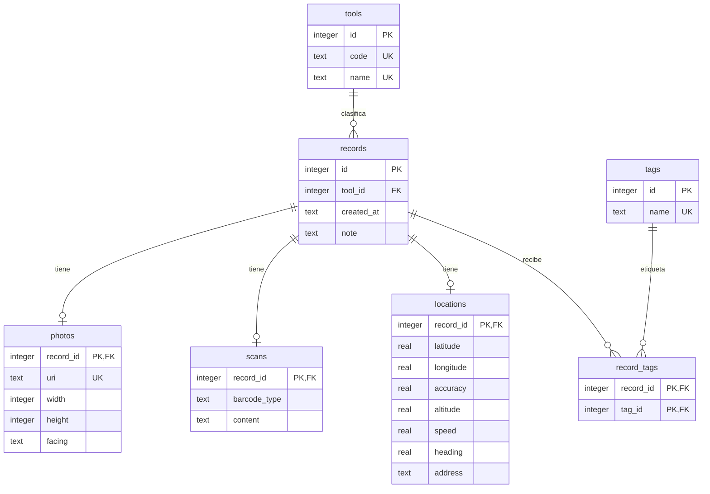

# Normalización de la base de datos

La app usa SQLite local. La dirección legible y las fotos son datos privados: no hay sincronización con un servidor.

## Tabla sin normalizar

| registro | herramienta | nombre  | fecha      | detalle                                 | etiquetas     |
| -------- | ----------- | ------- | ---------- | --------------------------------------- | ------------- |
| 1        | photo       | Cámara  | 2026-10-07 | URI, ancho, alto, cámara                | clase, prueba |
| 2        | scan        | Escáner | 2026-10-07 | QR, contenido                           | clase         |
| 3        | location    | GPS     | 2026-10-07 | latitud, longitud, precisión, dirección | prueba        |

El campo detalle agrupa varias propiedades y etiquetas contiene una lista. Ambos impiden tratar los valores como atributos atómicos.

## 1FN: valores atómicos

Separamos detalle en columnas atómicas y expandimos una fila por etiqueta:

| registro_id | etiqueta | herramienta | nombre  | fecha      | uri                 | ancho | tipo_codigo | contenido | latitud |
| ----------- | -------- | ----------- | ------- | ---------- | ------------------- | ----- | ----------- | --------- | ------- |
| 1           | clase    | photo       | Cámara  | 2026-10-07 | file:///ejemplo.jpg | 1200  | NULL        | NULL      | NULL    |
| 1           | prueba   | photo       | Cámara  | 2026-10-07 | file:///ejemplo.jpg | 1200  | NULL        | NULL      | NULL    |
| 2           | clase    | scan        | Escáner | 2026-10-07 | NULL                | NULL  | qr          | Hola      | NULL    |

Ahora cada celda tiene un valor, pero la clave candidata (registro_id, etiqueta) repite datos que dependen solamente del registro.

## 2FN: eliminar dependencias parciales

Los atributos del registro dependen de registro_id, no de la etiqueta. Separamos:

- records(registro_id, herramienta_id, nombre_herramienta, fecha, nota, detalles atómicos).
- tags(etiqueta_id, nombre).
- record_tags(registro_id, etiqueta_id), cuya PK compuesta no tiene atributos ajenos a ella.

Cada atributo depende de su clave completa. Sin embargo, nombre_herramienta depende de herramienta_id y no directamente de registro_id: queda una dependencia transitiva.

## 3FN: eliminar dependencias transitivas

Movemos los datos de herramienta al catálogo tools. Separamos detalles especializados para evitar columnas nulas y establecer relaciones uno a uno:

| Tabla       | Clave              | Dependencias                                                                 |
| ----------- | ------------------ | ---------------------------------------------------------------------------- |
| tools       | id                 | id → code, name                                                              |
| records     | id                 | id → tool_id, created_at, note                                               |
| photos      | record_id          | record_id → uri, width, height, facing                                       |
| scans       | record_id          | record_id → barcode_type, content                                            |
| locations   | record_id          | record_id → latitude, longitude, accuracy, altitude, speed, heading, address |
| tags        | id                 | id → name                                                                    |
| record_tags | record_id + tag_id | La relación no agrega atributos no clave                                     |

La dirección es una instantánea del servicio de geocodificación, no una tabla de ciudades ni un dato determinado únicamente por las coordenadas: una misma posición puede devolver distintos textos a lo largo del tiempo. No se almacena el nombre de la herramienta en records.

## Diagrama entidad-relación

Cada registro guardado por el servicio tiene exactamente un detalle. SQL impide asociar un detalle con el tipo de herramienta incorrecto mediante triggers. Las relaciones opcionales del diagrama permiten mostrar todos los subtipos; la escritura transaccional asegura que el servicio no deje un registro sin detalle.

## Integridad y migraciones

- PRAGMA foreign_keys = ON en cada conexión; las FK eliminan detalles y relaciones al borrar un registro.
- WAL facilita lectura mientras se escribe.
- Migración 1: tablas, catálogo y triggers.
- Migración 2: índices por fecha/tipo y búsqueda inversa de etiquetas.
- PRAGMA user_version se incrementa dentro de cada transacción BEGIN IMMEDIATE. Una migración fallida se revierte.
- Si la BD pertenece a una versión posterior, se rechaza la apertura para evitar pérdida de datos.
- Lecturas y escrituras se serializan sobre una conexión privada; registro, detalle y etiquetas se guardan en una transacción. foreign_keys se activa antes de BEGIN en esa misma conexión. No usamos el helper de Expo que abre otra conexión sin heredar ese PRAGMA.
- Datos de usuario se pasan como parámetros ?; execAsync se usa únicamente con SQL estático y el número interno de versión.
- CHECK, NOT NULL, UNIQUE y validación TypeScript son capas complementarias.

Los archivos schema.sql, seed.sql y queries.sql se pueden ejecutar en SQLite para practicar. El seed contiene ejemplos ficticios y una URI ilustrativa que no representa una foto real. La app comienza con historial vacío.
